# DQN and Double DQN with n-step returns

PyTorch implementation of DQN (Mnih et al., 2015) and Double DQN (van Hasselt et al., 2016) with uniform experience replay, a periodically copied target network, and n-step returns built from the replay buffer. Experiments:

- **CartPole-v1**: DQN vs. Double DQN with 1-, 5- and 10-step returns, their Q-value estimates, and two one-factor ablations of 1-step DQN (target-update interval, replay-buffer size).
- **Jumping Task**: Double DQN with 40-step returns on three configurations of a 60×60 pixel task in which the agent has to jump over obstacles.

| File | Contents |
|---|---|
| `dqn.py` | DQN agent: ε-greedy acting, TD targets, minibatch update, target-network refresh |
| `double_dqn.py` | Double DQN target |
| `replay_buffer.py` | FIFO replay buffer; n-step transitions are assembled when sampled |
| `epsilon_greedy_explorers.py` | ε-greedy action probabilities with even tie-breaking, linear ε schedule |
| `agent_environment.py` | episode loop, optional logging of predicted Q-values |
| `networks.py` | Q-networks for CartPole and the Jumping Task |
| `train_dqn_cartpole.py` | DQN vs. Double DQN for n ∈ {1, 5, 10} |
| `train_dqn_cartpole_ablations.py` | target-update-interval and buffer-size ablations |
| `train_dqn_jumping_task.py` | Double DQN on the Jumping Task |

## Method

**Targets.** For a transition sampled at time *t*, the buffer sums up to *n* rewards, *G* = *r*<sub>t</sub> + γ*r*<sub>t+1</sub> + … + γ<sup>k−1</sup>*r*<sub>t+k−1</sub>, stopping early at the end of the episode, and returns the matching bootstrap discount γ<sup>k</sup>. The targets are

- DQN: *G* + γ<sup>k</sup> max<sub>a</sub> *Q*<sub>target</sub>(*s*<sub>t+k</sub>, *a*)
- Double DQN: *G* + γ<sup>k</sup> *Q*<sub>target</sub>(*s*<sub>t+k</sub>, argmax<sub>a</sub> *Q*<sub>online</sub>(*s*<sub>t+k</sub>, *a*))

The bootstrap term is dropped at terminal states and kept at time-limit truncations. The n-step returns are computed from stored behaviour data without an off-policy correction.

**Updates.** One gradient step on the mean squared TD error per environment step, once the buffer holds `min_replay_size_before_updates` transitions. The target network is a copy of the online network, replaced every `gradient_updates_per_target_refresh` gradient steps.

## CartPole-v1

| Setting | Value |
|---|---|
| Q-network | MLP 4 → 64 → 64 → 2, ReLU |
| Optimiser | Adam, learning rate 1e-4, ε<sub>Adam</sub> = 1e-2 |
| Exploration | ε-greedy, ε annealed linearly from 1.0 to 0.001 over 12,500 steps |
| Replay | buffer 25,000, minibatch 128, updates start after 500 transitions |
| Target network | refreshed every 100 gradient steps |
| Discount | γ = 0.99 |
| Training | 500 episodes per run, 5 runs per configuration |

All curves show the per-episode training return (or predicted Q-value) averaged over the 5 runs, without smoothing.

### n-step returns, DQN vs. Double DQN

<p align="center">
  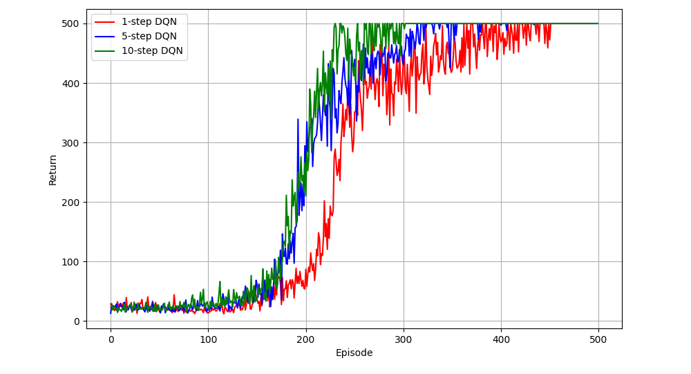
  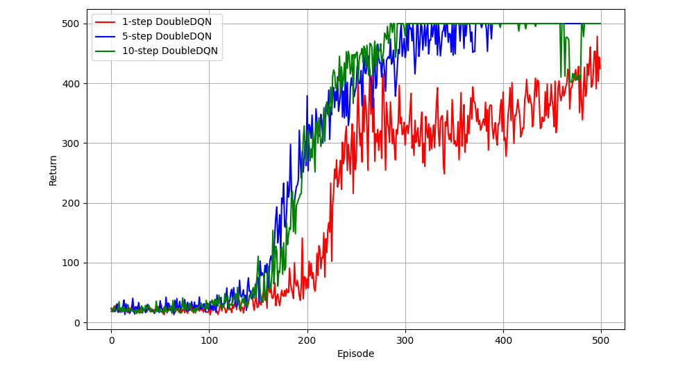
</p>
<p align="center"><sub>Left: DQN. Right: Double DQN.</sub></p>

<p align="center">
  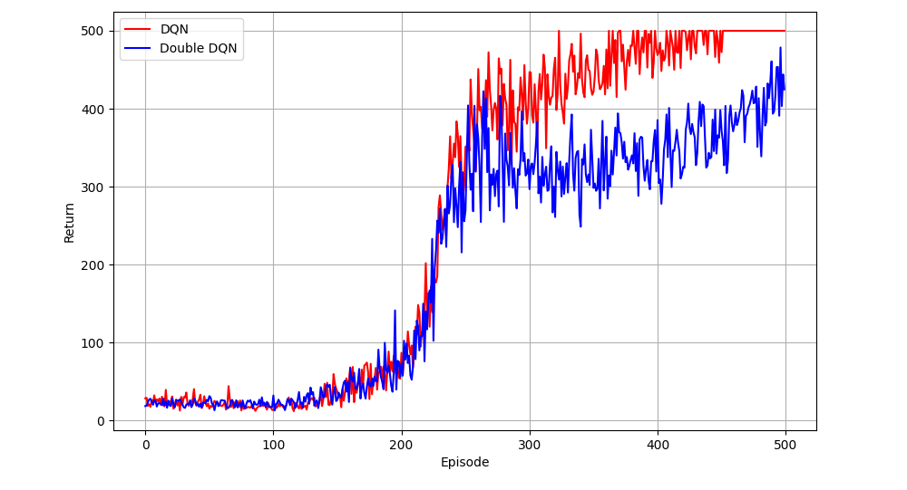
  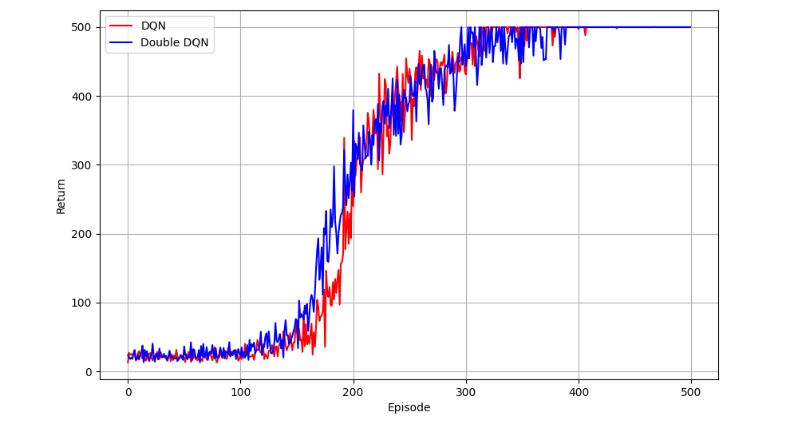
  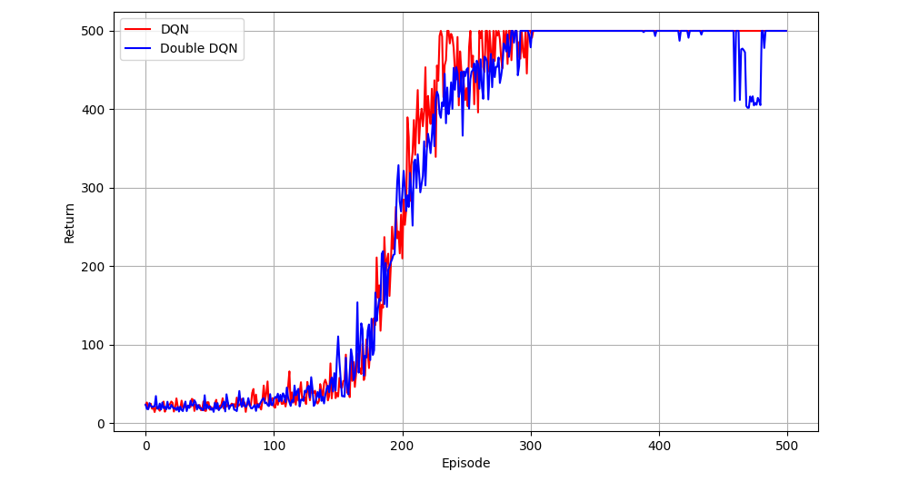
</p>
<p align="center"><sub>DQN (red) vs. Double DQN (blue) for n = 1, 5, 10.</sub></p>

- For both algorithms, 5- and 10-step returns start improving about 35–55 episodes before 1-step returns. Each update moves reward information back *n* steps instead of one.
- With n = 5 and n = 10, DQN and Double DQN are hard to tell apart, and both stay at the 500-step cap for most of the last 150 episodes.
- With n = 1, DQN reaches the cap at about episode 450, while Double DQN stays mostly between 300 and 450.

### Q-value estimates

<p align="center">
  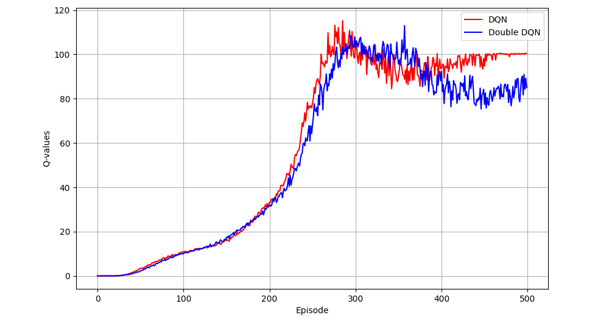
  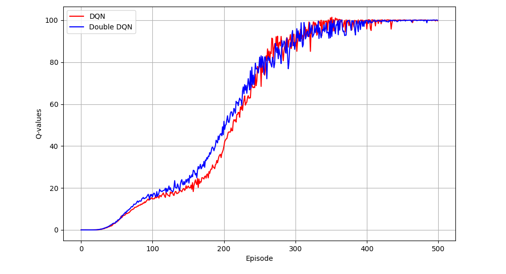
  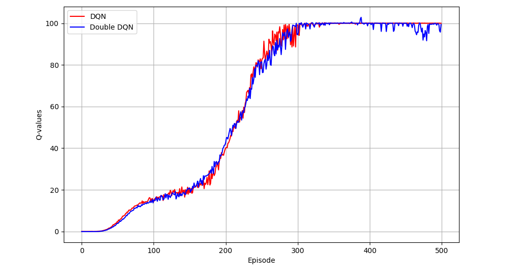
</p>
<p align="center"><sub>Mean predicted Q-value of the actions taken in each episode, n = 1, 5, 10.</sub></p>

The reward is +1 per step and the 500-step limit is a truncation, so no state has a true value above 1/(1 − γ) = 100.

- With 1-step returns, both algorithms overshoot that bound while the policy is improving (DQN peaks at about 115, Double DQN at about 113, between episodes 270 and 360) and then settle. With 5- and 10-step returns, the estimates rise to about 100 with no clear overshoot.
- Late in the 1-step runs, Double DQN's estimates sit at 80–90 and DQN's at 100. The returns differ the same way (Double DQN still fails in some episodes), so the gap comes from different policies, not from different estimation bias.

In these runs, switching to the Double DQN target did not remove the overshoot, while using 5- or 10-step returns did.

### Ablations of 1-step DQN

<p align="center">
  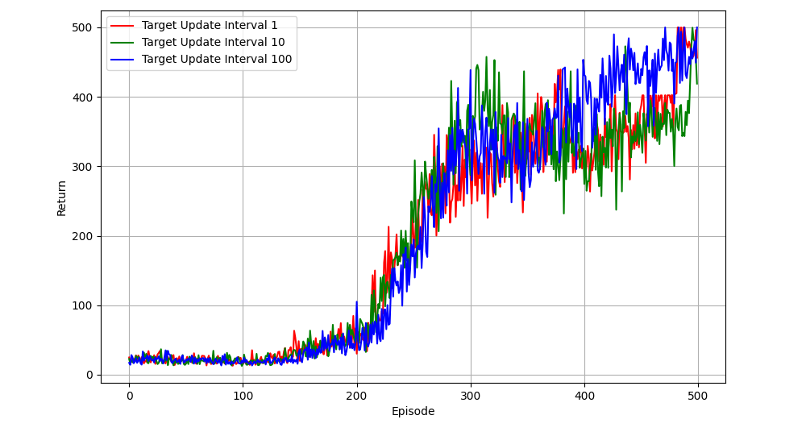
  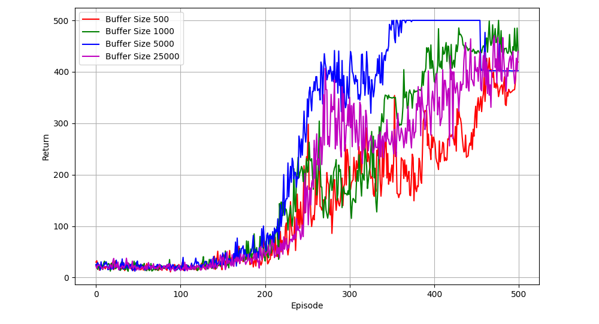
</p>
<p align="center"><sub>Left: target-update interval (gradient steps). Right: replay-buffer capacity.</sub></p>

- **Target-update interval** (1, 10, 100): the three curves overlap until about episode 400; interval 100 ends highest.
- **Buffer size** (500, 1,000, 5,000, 25,000): 5,000 learns fastest and holds the cap from about episode 360. At about episode 455 its mean drops from 500 to roughly 400 and stays flat, which is what one of the five runs collapsing to near-minimum returns would produce. 500 is the slowest. Two explanations fit these results: a small buffer only holds recent, highly correlated transitions, and a large one keeps many transitions from the early, poor policy. The ablation does not separate the two.

**How much these differences mean.** The default configuration (1-step DQN, interval 100, buffer 25,000) appears in all three experiments, each time as a separate set of 5 runs. In the main comparison its mean curve sits at 500 from about episode 450; in both ablation figures it is still moving between roughly 350 and 500 at episode 500. Gaps of that size between configurations are within run-to-run variation. Both ablations also change one setting while keeping the rest fixed, including the learning rate, so they show the effect under these settings, not the best value for each setting. A stronger protocol would tune the learning rate per configuration, use more runs, and report confidence intervals.

## Jumping Task

The agent sees a 60×60 binary image and chooses between moving right and jumping. Each step pays the number of pixels moved right; reaching the right edge pays +100 and ends the episode, touching an obstacle pays −1 and ends it. A successful episode therefore returns 156 (154 in configuration 2, where the agent is wider), so returns above 100 mark successes. Obstacle layouts are drawn at the start of every episode.

| Config | Layouts per episode |
|---|---|
| 1 | one 9×10 obstacle at x ∈ {20, 25, 30}, floor height ∈ {10, 20} |
| 2 | one 11×17 obstacle at x ∈ {30, 40}, floor height ∈ {10, 20}; 7×7 agent, jump height 24 |
| 3 | two 9×10 obstacles at x = 20 and x = 55, floor height ∈ {10, 20} |

**Agent.** Double DQN with an MLP (3600 → 64 → 64 → 2, ReLU) on the flattened frame with its one-pixel border set to zero. A CNN was tried first and did worse, so the final agent uses the MLP.

| Setting | Value |
|---|---|
| Returns | 40-step, γ = 1 |
| Optimiser | Adam, learning rate 1e-3, ε<sub>Adam</sub> = 1e-4 |
| Exploration | ε annealed linearly from 0.05 to 1e-6 over 100,000 steps |
| Replay | buffer 5,000 (from the buffer ablation), minibatch 16, updates start after 500 transitions |
| Target network | refreshed every 100 gradient steps (from the target-update ablation) |
| Training | 5,000 episodes per run, 3 runs per configuration |

With γ = 1 and *n* = 40, most targets cover the rest of the episode, so they are close to Monte Carlo returns and carry the +100 exit bonus back to the jump decision directly.

**Results.** Success rate over the last 500 training episodes (ε has decayed to 1e-6 by then):

| Config | Mean of 3 runs | Per run |
|---|---|---|
| 1 | 83.1% | 99.4%, 64.8%, 85.0% |
| 2 | 99.7% | 99.8%, 100.0%, 99.4% |
| 3 | 99.8% | 100.0%, 99.4%, 100.0% |

<p align="center">
  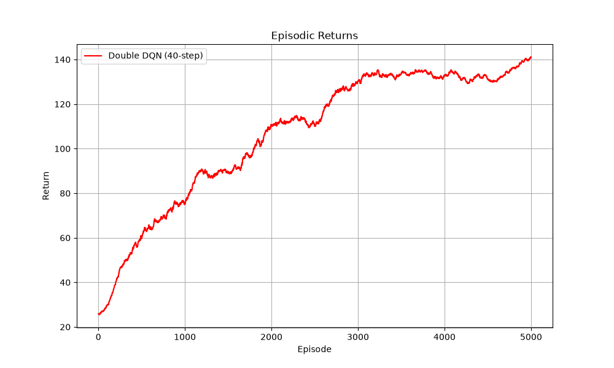
  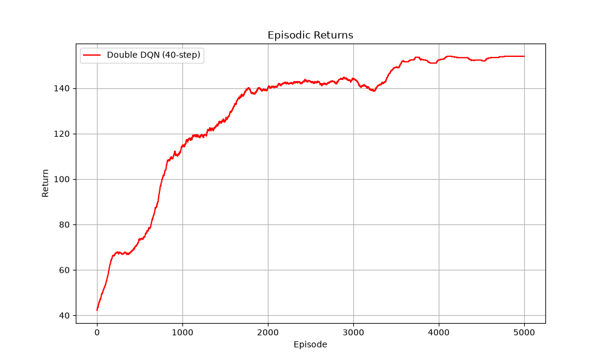
  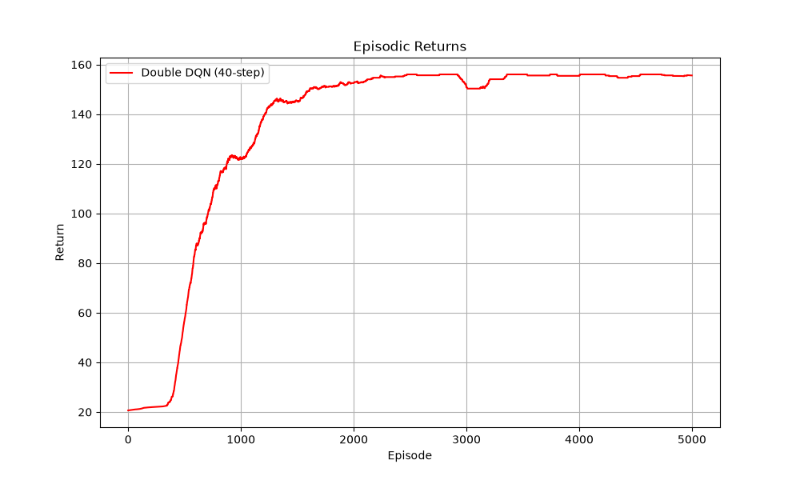
</p>
<p align="center"><sub>Training return averaged over 3 runs, centred moving average over ±100 episodes. Configurations 1, 2, 3 from left to right.</sub></p>

Configuration 1 has the most layouts (6) and is the only one that not every run solves.

## Reproducing

```bash
uv run python dqn/train_dqn_cartpole.py                # 2 agents x 3 n-step values x 5 seeds
uv run python dqn/train_dqn_cartpole_ablations.py      # both ablations, 5 seeds
uv run python dqn/train_dqn_jumping_task.py            # 3 configs x 3 runs x 5,000 episodes
uv run python dqn/train_dqn_jumping_task.py --plot-only
```

The figures and `results/` in this folder come from the original runs, which did not fix random seeds. The scripts now take `--seeds` (`--runs` for the Jumping Task) and save every run as a CSV, so new runs are repeatable but will not match these curves exactly. Per-run CartPole data from the original runs was not kept, only the figures.

## Attribution

The course provided the skeletons of the agent, replay buffer and episode loop, the CartPole training script with its hyperparameters and plotting helpers, and the Jumping Task configurations. The DQN and Double DQN updates, n-step returns, ε-greedy action probabilities, the ablation script, and the Jumping Task agent (network, preprocessing, hyperparameters) were written for this project.
