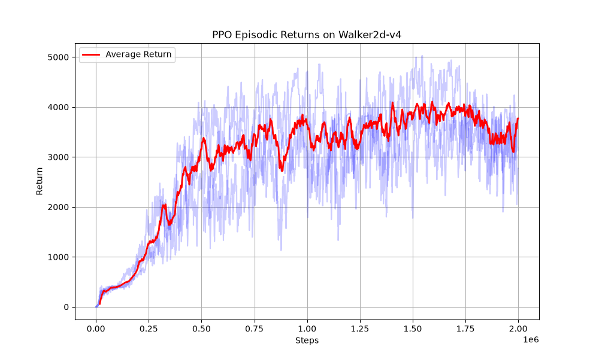
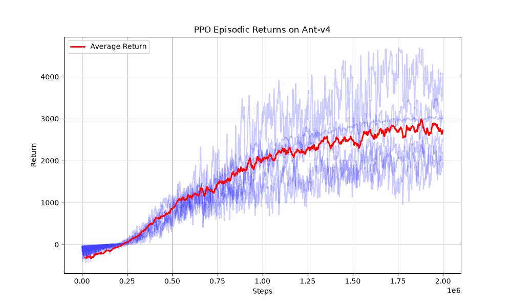
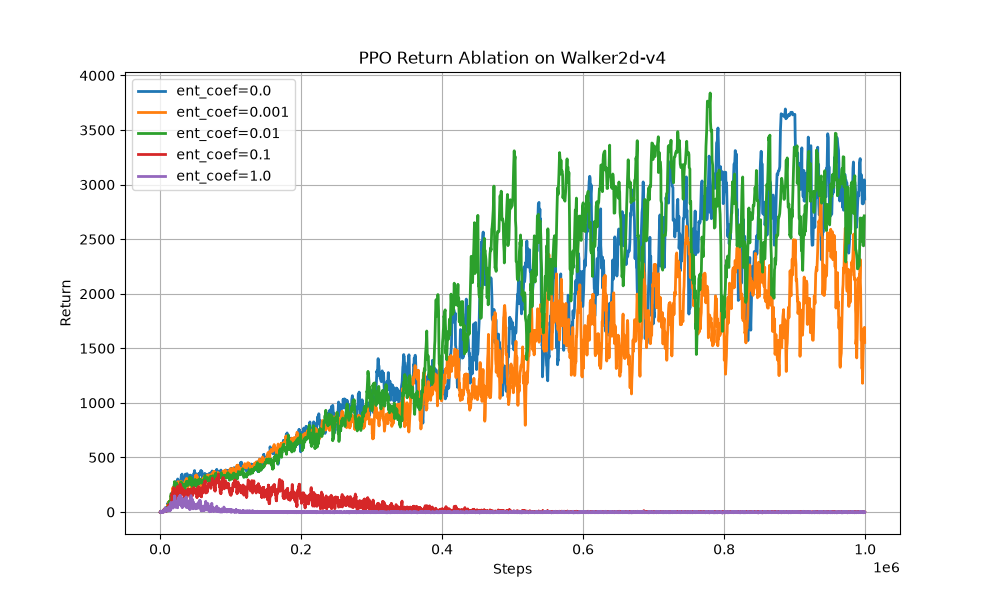
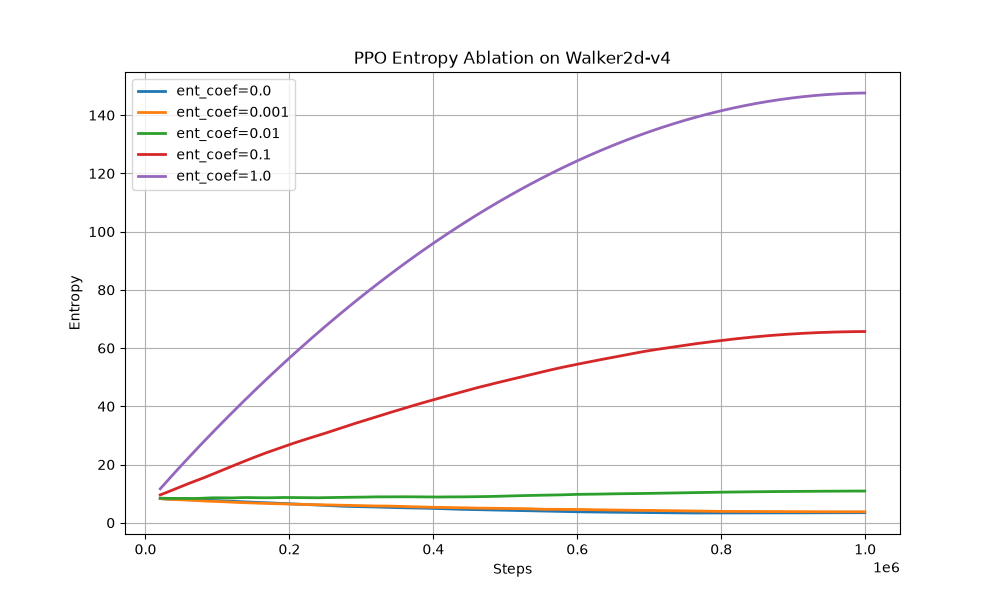

# PPO for continuous control

PPO (Schulman et al., 2017) with a Gaussian actor-critic, generalised advantage estimation, clipped policy and value losses, and observation/reward normalisation. Trained on MuJoCo Ant-v4 and Walker2d-v4, plus an ablation of the entropy-bonus coefficient on Walker2d-v4.

The implementation follows the design and default hyperparameters of CleanRL's [`ppo_continuous_action.py`](https://github.com/vwxyzjn/cleanrl), split into separate modules. An earlier version written without a reference implementation levelled off at a return of about 1,500–1,800 on Ant-v4 after 2M steps. The change that seemed to matter most was CleanRL's observation and reward normalisation, but this was not tested in a controlled ablation.

| File | Contents |
|---|---|
| `networks.py` | actor (Gaussian mean) and critic MLPs, learned state-independent log-std |
| `rollout_buffer.py` | on-policy storage for one rollout |
| `ppo_core.py` | rollout collection, GAE, PPO update |
| `env_factory.py` | environment wrappers (action clipping, normalisation) |
| `experiment_args.py` | hyperparameters and command-line arguments |
| `train_ppo.py` | multi-seed training on Ant-v4 or Walker2d-v4 |
| `ablation_entropy_walker2d.py` | entropy-coefficient ablation |
| `plot_results.py` | redraws the figures and prints the summaries below from `results/` |

## Setup

| Setting | Value |
|---|---|
| Networks | separate 64-64 tanh MLPs for the policy mean and the value; orthogonal initialisation (gain √2, 0.01 for the policy head, 1 for the value head); log σ initialised to 0 |
| Rollout | 2,048 steps from 1 environment per update |
| Update | 10 epochs × 32 minibatches (64 samples each), advantages normalised per minibatch |
| Optimiser | Adam, learning rate 3e-4 annealed linearly to 0, ε<sub>Adam</sub> = 1e-5, gradient-norm clip 0.5 |
| Losses | clipped surrogate (0.2), clipped value loss (0.2) with weight 0.5, entropy weight 0 |
| Returns | γ = 0.99, GAE λ = 0.95 |
| Wrappers | actions clipped to the action bounds; observations normalised with running statistics and clipped to [−10, 10]; rewards scaled by the running std of the discounted return and clipped to [−10, 10] |
| Training | 2M environment steps per run |

Episode returns are recorded before reward scaling, so all numbers below are raw environment returns. They come from the stochastic policy during training; there is no separate deterministic evaluation.

## Results

<p align="center">
  
  
</p>
<p align="center"><sub>Light lines: individual seeds (moving average over 10 episodes). Red: mean over seeds on a common step grid. Left: Walker2d-v4, 3 seeds. Right: Ant-v4, 6 seeds.</sub></p>

| Environment | Seeds | Mean return, last 50 training episodes | Per seed |
|---|---|---|---|
| Walker2d-v4 | 1–3 | 3238 ± 346 | 3085, 3358, 3270 |
| Ant-v4 | 1–6 | 2714 ± 752 | 3723, 3010, 1941, 1997, 2402, 3214 |

± is a 95% Student-t interval over seeds.

All three Walker2d-v4 seeds end above 3,000. On Ant-v4 the seeds split into two groups: seeds 1, 2 and 6 finish between 3,000 and 3,700, while seeds 3, 4 and 5 level off between 1,900 and 2,400. The two groups are clearly apart from about 1.5M steps on. Six seeds are too few to say whether longer training or different hyperparameters would close the gap; large differences between seeds are a known issue for policy-gradient methods on MuJoCo tasks (Henderson et al., 2018).

## Entropy-coefficient ablation on Walker2d-v4

**Question.** With a learned, state-independent standard deviation, how does the weight *c*<sub>e</sub> of the entropy bonus affect the return and the policy entropy?

**Setup.** *c*<sub>e</sub> ∈ {0, 0.001, 0.01, 0.1, 1.0}, 1M steps each, one seed. All five runs start from the same initial network weights and the same environment seed; everything else is as in the table above.

**Hypotheses**, stated before the runs:

1. *c*<sub>e</sub> = 0: entropy collapses early and the agent settles on a worse gait.
2. *c*<sub>e</sub> = 0.01 (the value the PPO paper uses on Atari): exploration lasts longer and the final return is higher.
3. *c*<sub>e</sub> = 1.0: the policy stays too random to hold a gait.

<p align="center">
  
  
</p>

| *c*<sub>e</sub> | Mean return, last 50 episodes | Policy entropy, first → last update |
|---|---|---|
| 0 | 2854 | 8.5 → 3.5 |
| 0.001 | 1866 | 8.5 → 3.8 |
| 0.01 | 2710 | 8.6 → 10.9 |
| 0.1 | −2 | 8.8 → 65.7 |
| 1.0 | −2 | 9.1 → 147.6 |

**Reading the entropy values.** Walker2d has 6 action dimensions and σ does not depend on the state, so the policy entropy is 6 · ½ log(2πe) + Σ<sub>i</sub> log σ<sub>i</sub> ≈ 8.5 + Σ<sub>i</sub> log σ<sub>i</sub>. The curves track the learned log standard deviations directly: the final 3.5 at *c*<sub>e</sub> = 0 means σ ≈ 0.43 per dimension on average, and 147.6 at *c*<sub>e</sub> = 1.0 means log σ ≈ 23.

**Findings.**

- Hypothesis 3 holds, already from *c*<sub>e</sub> = 0.1. The bonus adds the constant *c*<sub>e</sub> to the gradient of every log σ<sub>i</sub>, so once it outweighs the policy-gradient signal nothing stops σ from growing. At *c*<sub>e</sub> = 1.0 this happened from the first update: Adam moves a parameter with a consistently signed gradient by about one learning rate per step, and the 156,160 minibatch steps with the annealed learning rate add up to about 23.5, close to the final log σ ≈ 23.2. With σ that large the clipped actions are essentially random, and the walker falls after about 18 steps on average (29 at *c*<sub>e</sub> = 0.1).
- Hypotheses 1 and 2 are not supported. At *c*<sub>e</sub> = 0 the entropy fell from 8.5 to 3.5, yet this run ended with the highest return. At *c*<sub>e</sub> = 0.01 the entropy rose slightly and the run ended at a similar return (2710 vs. 2854).
- *c*<sub>e</sub> = 0.001 ended lower (1866), but its entropy curve is almost the same as at *c*<sub>e</sub> = 0. With one seed this gap cannot be told apart from seed-to-seed variation.

**Limitations.** One seed per coefficient, so only the collapse at *c*<sub>e</sub> ≥ 0.1 is a clear result; separating 0, 0.001 and 0.01 would need 5–10 seeds per value and confidence intervals. The runs are 1M steps, half the length of the main runs. A decaying *c*<sub>e</sub> was not tested.

## Implementation note

Gymnasium ≥ 1.0 vector environments reset a finished sub-environment on the *next* call to `step`, and that call ignores the action and returns reward 0. The rollout loop, written in the style of CleanRL's same-step reset, therefore stores one extra transition per episode (the final observation, an action with no effect, reward 0) and includes it in the update. The share of such transitions is about 1/episode-length, i.e. 0.1% for 1,000-step episodes. Masking them out of the loss would remove the effect.

## Reproducing

```bash
uv run python ppo/train_ppo.py --env Walker2d-v4 --num_runs 3          # seeds 1-3
uv run python ppo/train_ppo.py --env Ant-v4 --num_runs 6               # seeds 1-6
uv run python ppo/ablation_entropy_walker2d.py --total_timesteps 1000000
uv run python ppo/plot_results.py                                      # figures and summaries from results/
```

`results/main/<env>_seed<k>.csv` holds the global step and return of every training episode; `results/entropy_ablation/` holds the same per coefficient, plus the policy entropy after every update. The runs used Gymnasium 1.2.3 and MuJoCo 3.5.0 (pinned in `pyproject.toml`).

## References

- J. Schulman, F. Wolski, P. Dhariwal, A. Radford, O. Klimov. Proximal Policy Optimization Algorithms. arXiv:1707.06347, 2017.
- S. Huang, R. F. J. Dossa, C. Ye, J. Braga, D. Chakraborty, K. Mehta, J. G. M. Araújo. CleanRL: High-quality Single-file Implementations of Deep Reinforcement Learning Algorithms. JMLR 23(274), 2022.
- P. Henderson, R. Islam, P. Bachman, J. Pineau, D. Precup, D. Meger. Deep Reinforcement Learning That Matters. AAAI 2018.
